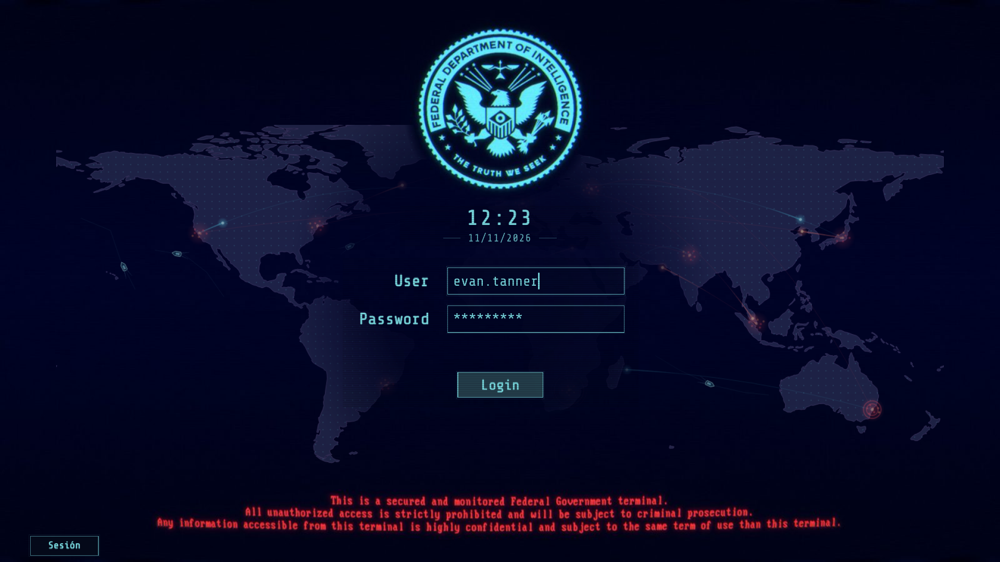
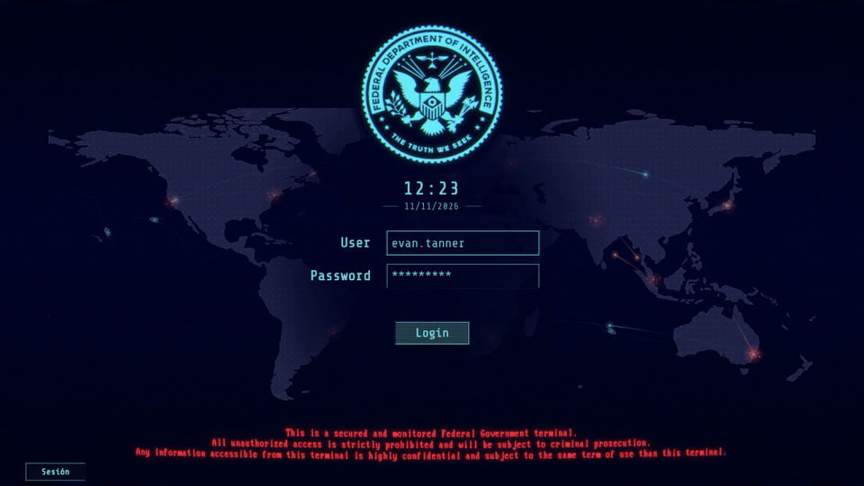

<div align="center">

# FBI Theme Login GUI

**Una pantalla de acceso con estética CRT, mapa mundial animado y tráfico marítimo.**

Tema para **SDDM**, construido con **Qt 6 / QML** y orientado a **KDE Plasma 6 sobre Arch Linux**.


[](https://github.com/alexandruraboaca00/FBI_theme_Login_GUI/actions/workflows/ci.yml)

**[Vista previa](#vista-previa) · [Instalación](#instalación) · [Personalización](#personalización) · [Documentación](docs/README.md)**

</div>



<p align="center"><sub>Captura del greeter real en modo de prueba. Los datos del formulario son ficticios.</sub></p>

<details>
<summary><strong>Ver el tema en movimiento</strong> — partículas, ondas de llegada y barcos</summary>



Secuencia capturada del greeter en test-mode; no es una animación conceptual.

</details>

## La experiencia

| Acceso integrado | Un mapa con vida | Instalación reversible |
|---|---|---|
| Usuario recordado, contraseña oculta, Enter y recuperación del foco tras un fallo. | Focos cálidos, partículas con estela y cuatro barcos con rumbo y estela en V. | Simulación por defecto, manifiesto de archivos y backup automático al activar. |
| Sesiones y teclado mediante los modelos de SDDM; energía con confirmación. | Reloj bajo el emblema, fecha `dd/MM/yyyy`, hora 24h y acabado CRT configurable. | Restauración desde TTY y protección frente a archivos ajenos o cambios posteriores. |

El mapa funciona **completamente offline**. Los ataques y barcos son decorativos;
no muestran actividad de tu red ni tráfico marítimo real.

## Plataforma y compatibilidad

**SDDM carga la pantalla de acceso; Qt 6 la dibuja; KDE Plasma 6 es el escritorio.**
El tema se aplica al greeter de SDDM, no al escritorio ni al bloqueo de Plasma.
GDM, LightDM y Plasma Login Manager utilizan otros mecanismos.

| Componente | Referencia de desarrollo |
|---|---|
| Sistema / escritorio | Arch Linux · KDE Plasma 6.8.2 |
| Gestor / runtime | SDDM 0.21.0-7 · Qt 6.12.0 |
| Greeter / sesión | Greeter configurado X11 · Plasma Wayland detectada |
| Objetivo mínimo Qt | 6.5 declarado; validación realizada en 6.12 |
| Resoluciones de prueba | 1366×768, 1600×900, 1920×1080 y 2560×1440 |
| Escala y pantallas | DPR 1.25 y dos monitores simulados |

Las pruebas gráficas usan **offscreen/software**. No acreditan autenticación PAM,
GPU física o hotplug; consulta la [matriz de validación](docs/testing.md).
Qt 5 y Plasma 5 quedan fuera del objetivo de soporte. Otros entornos con SDDM Qt 6
no se han verificado. [Compatibilidad y dependencias completas →](docs/dependencies.md)

## Vista previa

Necesitas SDDM activo con `sddm-greeter-qt6`, Qt 6, Python 3 y una sesión instalada.
No hace falta compilar el tema. En Arch:

```bash
sudo pacman -S --needed sddm qt6-base qt6-declarative python

git clone https://github.com/alexandruraboaca00/FBI_theme_Login_GUI.git
cd FBI_theme_Login_GUI
./scripts/check-dependencies.sh
./scripts/preview.sh
```

La ventana de prueba utiliza una copia temporal de la versión final con focos y
barcos. Cierra la ventana para salir. **No introduzcas contraseñas reales en test-mode**:
la vista previa no está conectada al daemon de autenticación.

## Instalación

Comprueba primero la vista previa. Los scripts de activación requieren **elarun y
Breeze** instalados como alternativas, y que SDDM sea tu gestor activo.
La [guía de instalación](docs/installation.md) detalla cómo comprobarlo y recuperar
la configuración si el siguiente greeter falla.

**Revisar las operaciones, sin modificar el sistema:**

```bash
./scripts/install.sh
./scripts/activate.sh
```

**Instalar y seleccionar el tema:**

```bash
sudo ./scripts/install.sh --apply
sudo ./scripts/activate.sh --apply
```

El tema aparecerá en el siguiente inicio del greeter, cuando cierres sesión o
reinicies normalmente. **Los scripts no reinician SDDM ni cierran tu sesión.**

| Destino | Contenido |
|---|---|
| `/usr/share/sddm/themes/federal-intelligence/` | Tema autocontenido |
| `/etc/sddm.conf` | Selección `[Theme] Current`, con backup previo |
| `/var/lib/sddm-custom/` | Manifiesto y copias de seguridad protegidas |

El identificador instalable se conserva como `federal-intelligence`; el repositorio
se llama `FBI_theme_Login_GUI`. No se cambia PAM, autologin, servidor gráfico,
pantalla de bloqueo ni gestor de acceso. [Instalación, actualización y retirada →](docs/installation.md)

## Personalización

Crea `theme.conf.user` junto al `theme.conf` instalado. Ejemplo:

```ini
[General]
MapOpacity=0.50
ShowShips=true
CRTStrength=0.20
Animations=true
```

Puedes ajustar el mapa, los barcos, las animaciones, el CRT, el color y el reloj.
[Opciones, límites y ejemplos →](docs/configuration.md)

## Recuperación

Para recuperar la configuración previa, desde el repositorio:

```bash
sudo ./scripts/restore.sh --apply
```

Si el greeter falla, entra en una consola con **Ctrl+Alt+F3** y ejecuta ese comando.
Los respaldos se conservan. Si necesitas restauración manual, sigue la
[recuperación desde TTY](docs/troubleshooting.md#recuperación-desde-tty).

## Documentación y desarrollo

| Para usar el tema | Para mantener el proyecto |
|---|---|
| [Instalación y recuperación](docs/installation.md) | [Arquitectura QML](docs/architecture.md) |
| [Personalización](docs/configuration.md) | [Diseño y recursos](docs/design.md) |
| [Compatibilidad y dependencias](docs/dependencies.md) | [Pruebas y límites](docs/testing.md) |
| [Preguntas frecuentes y problemas](docs/troubleshooting.md) | [Contribuir](CONTRIBUTING.md) |

[**Índice documental**](docs/README.md) · [**Referencias oficiales y atribuciones**](docs/references.md)

Las pruebas se reproducen con `./scripts/test.sh`. La CI comprueba el ciclo de
instalación y las rutas marítimas; las pruebas Qt/QML y capturas se ejecutan localmente.
[Ver comprobaciones automáticas](https://github.com/alexandruraboaca00/FBI_theme_Login_GUI/actions/workflows/ci.yml).

## Licencia y créditos

El **código** se publica bajo [BSD de 3 cláusulas](LICENSE). Share Tech Mono mantiene
su licencia SIL OFL y los datos Natural Earth son de dominio público. La referencia
gráfica y sus apariciones en capturas conservan sus derechos originales y quedan
excluidas de la licencia del código.

[Licencias y procedencia de los recursos →](src/theme/NOTICE.txt) · [Fuentes oficiales →](docs/references.md)
